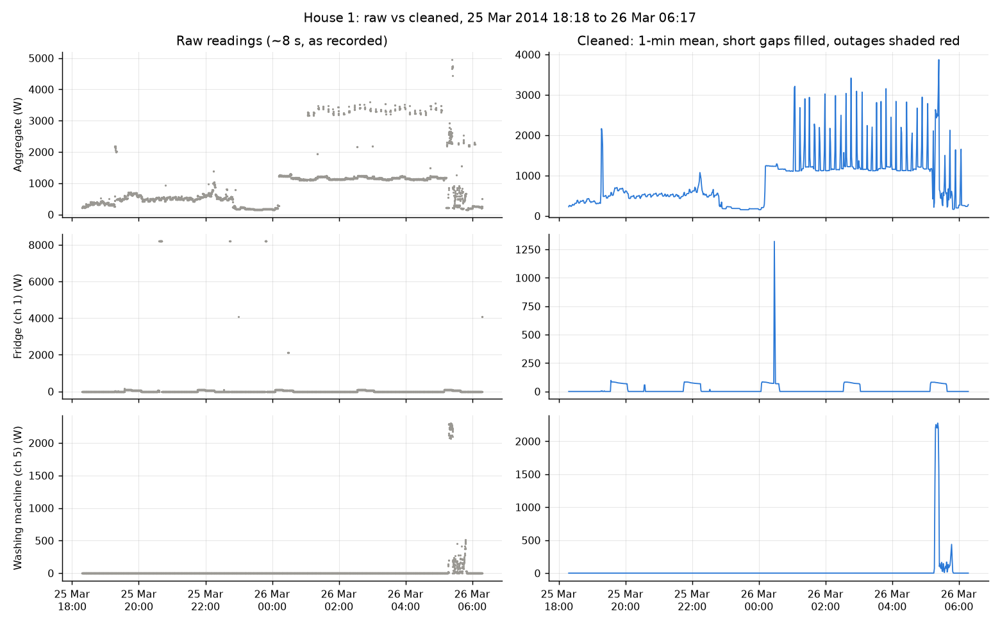
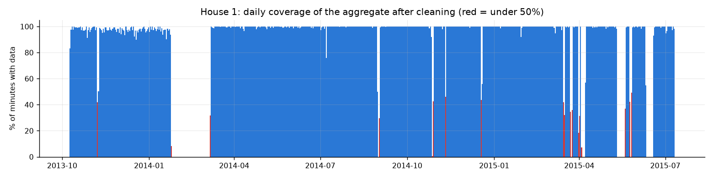

# Data: coverage, quality and cleaning

## Source

REFIT Electrical Load Measurements, University of Strathclyde (Murray et al. 2017). The dataset covers 20 houses in the Loughborough area between October 2013 and July 2015. Each house has one current clamp on the mains (the aggregate) and nine plug-in Individual Appliance Monitors (IAMs). Only active power is recorded, in watts, and the logger polled the sensors every 6-8 seconds.

Two details from the readme drive most of the cleaning decisions:

- sensors only log when the load changes, and the logger fills in the values in between;
- the ten sensors are not synchronised, so an appliance can show a step a few seconds before the aggregate does.

Files used:

| Part | Source | Files | Columns |
|---|---|---|---|
| 1 | `REFIT_RAW_081116.7z` from the Strathclyde portal | `RAW_House1_Part1.csv` (4,377,877 rows), `RAW_House1_Part2.csv` (4,140,886 rows) | all |
| 2, 3 | The creators' Zenodo deposit of the cleaned data (DOI 10.5281/zenodo.5063428), MD5 checked | `CLEAN_House1.csv`, `CLEAN_House2.csv`, `CLEAN_House3.csv`, `CLEAN_House5.csv`, `CLEAN_House11.csv` | UNIX, Aggregate, washing-machine channel, Issues; in Part 3 also the other heating appliances (used only to explain errors) |

The raw readme describes the raw files as "completely raw apart from accounting for daylight savings time". Each house's raw data comes in two files from two versions of the logging database:

- **`_Part1`** (October 2013 to 30 September 2014) logs an unavailable sensor as 0.
- **`_Part2`** (27 June 2014 to July 2015) logs it as NaN. Part 2 also writes each sensor's update as its own row, so 59% of its rows have some sensors blank.

The two files overlap for 95 days.

**Energy.** kWh is the sum of the 1-minute power values in W, divided by 60,000.

Washing-machine channels, from `CLEAN_READ_ME_081116.txt`:

| House | Washing machine (make, model) | Channel | Other heating appliances on a monitor |
|---|---|---|---|
| 1 | Beko WMC6140 | Appliance5 | washer dryer (4), dishwasher (6), electric heater (9) |
| 2 | LG F1289TD | Appliance2 | dishwasher (3), kettle (8) |
| 3 | make and model not given | Appliance6 | tumble dryer (4), dishwasher (5), kettle (9) |
| 5 | AEG L99695HWD | Appliance3 | tumble dryer (2), dishwasher (4), kettle (8) |
| 11 | make and model not given | Appliance3 | dishwasher (4), kettle (7) |

- **House 5's machine is a washer-dryer.** Its model number belongs to a heat-pump washer-dryer, not a plain washing machine, so some of its "cycles" include drying. It stays in because the readme labels the channel "Washing Machine", and it shows how households differ.
- **House 4 is skipped** because it has two washing machines on two channels.
- **Why these five homes.** They are the homes with a single washing machine in the creators' Zenodo copy of the cleaned data. That copy has one CSV per house with MD5 checksums, so the download could be checked file by file. The full cleaned archive on the Strathclyde portal sits behind a browser check.

## What the UNIX column means

The readme calls the column a UTC timestamp. Checked against the data, it is not UTC everywhere, and this matters for every hour-of-day result.

**Raw files hold UK local clock time.** Three pieces of evidence (printed by `clean_house1.py`):

- UNIX jumps forward by an hour at the spring clock changes: 3,605 s on 30 March 2014 and 3,607 s on 29 March 2015.
- It steps back by 3,597 s at the autumn change on 27 October 2013.
- With true UTC, nothing would happen at those moments. Also, the DATETIME text matches UNIX read as a clock time to within one second on every row.

**Clean files switch convention part-way.** Lining up the clean and raw aggregate week by week in all five houses gives the same answer:

- through 30 September 2014, the clean files are true UTC, one hour behind the raw local time in summer;
- from October 2014, they are UK local time.

The switch is where the first logging database ends in every house. It looks like the official cleaning converted the `_Part1` data to UTC but not the `_Part2` data. The scratch checks behind this table are not part of the scripts; the House 1 result is reproduced by `clean_house1.py` below.

| House | Summer weeks where clean = raw - 1 h | Summer weeks where clean = raw |
|---|---|---|
| 1 | 25 (April to September 2014) | 16 (from 29 September 2014) |
| 2 | 24 | 11 |
| 3 | 24 | 12 |
| 5 | 25 | 15 |
| 11 | 15 (June to September 2014) | 16 |

**How the scripts handle it.** `uk_time()` in `common.py` reads raw UNIX values as UK local time. It reads clean UNIX values as UTC before 1 October 2014 and as UK local time after. The hour that happens twice when the clocks go back cannot be placed and is dropped (2,185 raw House 1 rows).

**How the fix was checked.**

- **Raw vs official, before and after the fix.** After the fix, our cleaned raw House 1 lines up with the official cleaned House 1 with no time offset in 21 of 22 months (February 2014 has too little data to test). The aggregate correlation went from 0.77 to 0.991.
- **Effect on the model.** Chronological F1 rose from 0.395 to 0.409, because the hour-of-day feature now means the same thing in the training and test months.

## Part 1: what the raw House 1 data looks like

All numbers come from `python src/clean_house1.py` and are also in `outputs/tables/house1_audit.csv` and `house1_channel_audit.csv`.

| Check | Result |
|---|---|
| Files and rows | 2 files, 8,518,763 rows |
| Period covered (UK time) | 9 October 2013 14:06 to 10 July 2015 11:56 |
| Timestamps that do not parse | 0 (UNIX and DATETIME) |
| DATETIME text more than 1 s from UNIX | 0 |
| Rows in the repeated autumn hour (cannot be placed) | 2,185 |
| Rows out of order | 2: the start of Part 2 (it begins 95 days before Part 1 ends) and the autumn 2013 clock change |
| Duplicate timestamps | 1,211,048: 884,707 with identical readings, 326,341 with different readings |
| Sampling interval | median 7 s; 53.2% of intervals between 6 and 10 s, 32.3% under 6 s |
| Gaps between readings | 4,040 over 1 minute, 390 over 5 minutes, 21 over 1 hour, 12 over 1 day |
| Longest gap | 24 January to 6 March 2014, 41.6 days |
| Aggregate blank / exactly 0 W | 188,973 / 12 |
| Negative values | 0 |
| Aggregate over 25 kW | 3 (largest 29,159 W) |
| Appliance monitor over 4 kW | 3,273 across the nine monitors (largest 98,301 W) |

What the numbers mean:

- **Most duplicates are repeated rows inside Part 1** (1,004,404), and most of those repeat the same readings. Part 2 adds 14,755 and the two files share 191,889 timestamps in their overlap. Part 2's blank-sensor rows explain many of the "different readings" duplicates. Two rows with the same time often carry different sensors, so averaging them merges them into one complete reading.
- **The many intervals under 6 seconds** come from the same two sources: Part 2's one-sensor rows, and the two files interleaving during the overlap. A direct check found that Part 1 and Part 2 use the same clock in the overlap, so averaging them is safe.
- **The long gaps are outages, not slow sampling.** The 41.6-day gap is the February 2014 outage named in the readme. The next longest are 8.6 days (May 2015), 7.5 days (June 2015), 4.4 days (April 2015) and 2.3 days (March 2015).
- **The values above the limits are logger glitches, not real power.** The same impossible numbers repeat on different channels, for example 98,301, 73,725 and 65,535 (2^16 - 1) on plug monitors rated at about 3 kW. Appliance4 (the washer dryer) has the most, 2,085.
- **A blank aggregate is a Part 2 sensor row without the clamp.** A 0 W aggregate (12 rows) only appears in Part 1, where 0 means "sensor unavailable".

## Cleaning pipeline (`src/clean_house1.py`)

1. **Parse.** Read UNIX as UK local clock time (see above) and drop rows that do not parse, or that fall in the repeated autumn hour.
2. **Sort and merge duplicates.** Sort by time. When several rows share a timestamp, keep one row with the mean of their readings (blanks ignored). Most duplicates are exact copies, so the rule only changes anything for rows whose values differ.
3. **Remove impossible values** by setting them to missing, not to 0:
   - negative power on any channel;
   - aggregate above 25 kW, since a UK home on a 100 A main fuse cannot draw much more than 23 kW;
   - plug monitor above 4 kW, since monitors sit on 13 A sockets (about 3.1 kW at most) and 4 kW is also the cut-off the official cleaning used;
   - aggregate of exactly 0 W, because a lived-in house always draws something (fridge, standby loads), so in Part 1 a 0 is the "sensor unavailable" placeholder.
4. **Resample** to 1-minute means. A minute holds about 9 readings on average.
5. **Handle gaps.** Gaps of up to 5 minutes are forward-filled. Longer gaps stay missing and get `is_outage = True`, and `is_filled` marks the minutes that were filled.

The result is `outputs/house1_clean_1min.parquet` (git-ignored, 920,031 minutes): Aggregate, Appliance1-9, is_filled and is_outage.

## Why these gap and outlier rules

- **5 minutes, forward fill.** REFIT logs a value only when the load changes, so a short gap usually means "nothing changed", and holding the last value is the natural guess. Linear interpolation would invent ramps, for example a kettle slowly switching off. Five minutes is shorter than nearly every appliance phase that matters here, so a filled gap cannot hide a washing-machine heater block.
- **Measure each gap before filling it.** pandas' `ffill(limit=5)` would also fill the first 5 minutes of a 41-day outage. The script measures every gap first and fills only the short ones.
- **Long gaps stay missing.** Filling hours of data would fabricate appliance use, or non-use. The `is_outage` flag lets later steps skip these periods and keeps daily and monthly totals honest about missing data.
- **Missing instead of 0 for impossible values.** The official cleaning replaced monitor spikes with 0. Setting them to missing lets the minute mean use the other readings in that minute, and does not claim the appliance was off.

## After cleaning

| | |
|---|---|
| Minutes in the period | 920,031 (639 days) |
| Unique timestamps after merging duplicates | 7,306,138 |
| Values removed (negative or over the limits) | 3,276 |
| Minutes filled (gaps of up to 5 minutes) | 853 |
| Minutes flagged as outage | 114,398 (12.4%), in 375 outages, 21 of them longer than an hour |
| Longest outage | 41.6 days (24 January to 6 March 2014) |
| Still missing per channel | 12.4-13.1%, except the electric heater monitor (Appliance9) at 23.0% |

Raw 8-second readings are on the left, and the cleaned 1-minute series on the right, for the aggregate and two monitors (fridge and washing machine). The script picks a 12-hour window that has removed glitches on the plotted channels and a wash. Here that is 25-26 March 2014.

- **The fridge glitches are removed.** The monitor logged 8,200 W three times and about 4,100 W twice, and all five disappear.
- **One glitch gets through.** A single 2,100 W fridge reading passes, because it is under the 4 kW plug limit, and shows up as a 1,320 W one-minute spike. A per-appliance limit would catch it (see remaining concerns).
- **The aggregate shows the household's night heating.** It sits at a steady 1.2 kW from midnight, with regular 3.4 kW spikes.
- **The wash looks the same raw and cleaned.** At 05:15 there is a 2.2 kW heater block, motor activity and a final spin.

The coverage plot shows the share of minutes per day with an aggregate value after cleaning. The February 2014 outage is the long white stretch, and spring and early summer 2015 have several multi-day outages.

## Check against the official cleaned file

The script compares the cleaned 1-minute House 1 with `CLEAN_House1.csv`, resampled the same way, over the minutes where both have data:

| Channel | Minutes compared | MAE (W) | Within 10 W | Correlation |
|---|---|---|---|---|
| Aggregate | 803,498 | 9.1 | 93.6% | 0.991 |
| Appliance1 (fridge) | 802,320 | 0.4 | 99.3% | 0.992 |
| Appliance5 (washing machine) | 797,426 | 0.6 | 99.5% | 0.991 |
| Other seven monitors | 707,436-803,508 | 0.0-0.4 | 98.9-99.9% | 0.973-0.999 |

- **The simple pipeline almost reproduces the official one.** The aggregate differs most where the two pipelines treat glitches and partial rows differently.
- **The official file fills only some of our outages.** It has values for just 155 of our 114,398 outage minutes. So in its long outages there are no rows at all, rather than forward-filled ones, at least in House 1. (House 3 is different; see below.)

## Cleaned data used in Parts 2 and 3

According to its readme, the official cleaning:

- corrected UK daylight-saving time (only partly, see above);
- moved sections of monitor columns back to the right appliance after resets or moves;
- forward-filled NaN values;
- replaced monitor spikes above 4,000 W with 0;
- added an `Issues` column, set to 1 when the monitors add up to more than the aggregate.

Four extra checks were added before using this data. Each one was added because the data showed the problem.

- **Frozen aggregate.** Because the cleaned files forward-fill gaps, an outage can look like a perfectly flat line instead of a gap. A real house aggregate never holds exactly the same 1-minute mean for an hour (the fridge alone moves it), so any run of 60 or more identical minutes is treated as missing. House 3 has 480 such stretches, 1 to 38 hours long (for example 1,528 W for 21 hours), while its appliance monitors keep changing underneath.
- **Stuck washing-machine monitor.** This is the same idea applied to the washing-machine channel, but only for values of 20 W or more, because long runs of exact zeros are normal. At one point House 5's monitor held exactly 2,129 W for 13 hours. Left in, that would count as a single 28 kWh "wash".
- **Silent washing-machine monitor.** Every home here washes at least about once a week. So four or more weeks without a single minute above 20 W, while the house is still being measured, is treated as a monitor that was unplugged or moved, and those minutes count as unknown rather than "off". This happened in House 11 from 26 April 2015: it recorded 4-11 washes a month before that, and none afterwards. The other stretches this rule catches sit almost entirely inside the February 2014 outage.
- **Issues flag.** Because the sensors are not synchronised, single flagged readings appear every time an appliance switches on before the aggregate catches up, and those are exactly the washing machine's heater on/off minutes. Dropping every minute with a flag would quietly remove the hardest minutes from the evaluation, so a minute is dropped from the model only when more than half of its readings are flagged.

| House | Missing | Frozen aggregate | Stuck WM monitor | Silent WM monitor (minutes with data) | Issues: any / most |
|---|---|---|---|---|---|
| 1 | 12.6% | 0.06% | 0.03% | 2.0% | 1.8% / 0.5% |
| 2 | 24.6% | 0.57% | 0% | 0.4% | 1.5% / 0.1% |
| 3 | 11.4% | 11.7% | 0% | 0.4% | 6.9% / 4.6% |
| 5 | 9.3% | 0.27% | 2.2% | 0% | 7.6% / 4.8% |
| 11 | 11.0% | 0.71% | 0% | 12.4% | 1.7% / 0.7% |

All values are shares of each house's minutes.

**House 11's monitor reads more than the whole house.** During House 11's heating minutes (washing machine above 1 kW), the washing-machine monitor reads more than the whole-house aggregate in 60% of them, for example 2.3 kW against 2.0 kW. That is physically impossible, so one of the two sensors is mis-calibrated. Two thirds of these minutes carry a majority Issues flag and are excluded from the model, so House 11's model results are the least trustworthy of the five. For comparison, only 1% of House 2's heater minutes and 8% of House 3's show the same problem.

## Remaining concerns

- **Zeros on plug monitors in Part1 files.** A 0 there can mean "off" or "monitor unavailable". There is no way to tell the two apart, so they were left as 0.
- **Glitches under the plug limit.** The 4 kW limit is the same for every monitor. A fridge reading of 2,100 W passes even though a fridge never draws that. Per-appliance limits (for example 500 W for a fridge) would catch more glitches, but they need a decision per appliance type.
- **Timestamps.** The UNIX convention differs between raw and clean files and changes on 1 October 2014 inside the clean files (above). The fix is checked against House 1 in detail, and the switch date was confirmed in all five houses.
- **Sensor timing and calibration.** The ten sensors are not synchronised to the second, so the first and last minute of a step can disagree between a monitor and the aggregate. In House 11 the monitor and clamp disagree for whole heater blocks. A smaller mismatch may exist elsewhere without being visible.
- **Moved monitors.** The readme says occupants may have moved monitors to other appliances. The raw cleaning does not correct this. For House 1, every channel matches the official cleaned file closely (correlation 0.97 or more), so no large moves are visible there.
- **Long outages.** These include the February 2014 outage named in the readme. They are flagged, not filled, so any daily or monthly totals that touch them are underestimates.
- **Washer-dryer in House 5.** Drying runs count as washing-machine use in that house. From February 2015 the household ran long evening wash-and-dry programmes (6-9 hours) that hardly appear in 2014, a change in behaviour that the time split exposes.
- **Resolution.** 8-second polling misses anything shorter. The 1-minute means also smooth the spin peaks, so "peak power" here means the highest 1-minute mean.
- **Monitors covering several devices.** "Television Site" and "Computer Site" can be several devices on one monitor. They are not used here, but they matter if the work is extended to other appliances.
