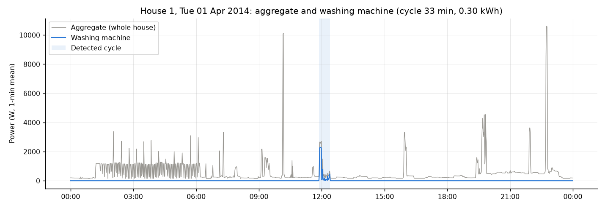
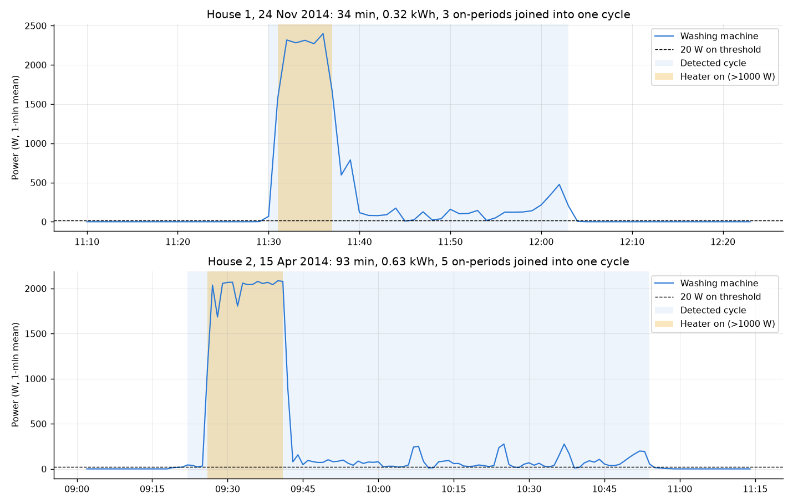
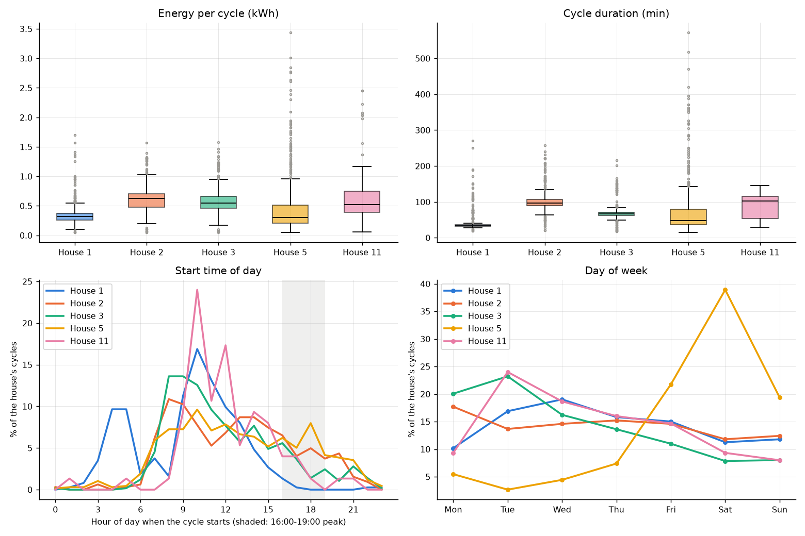
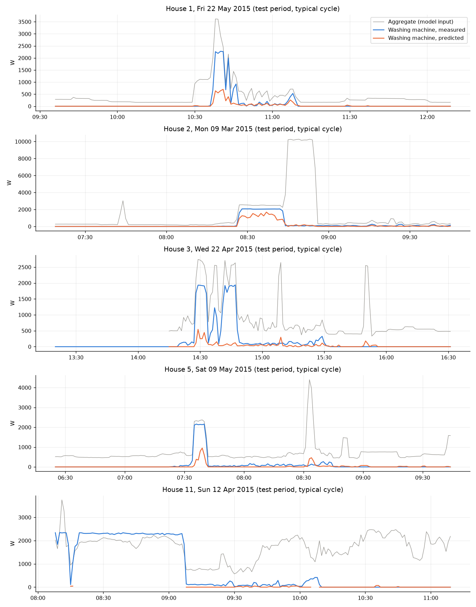
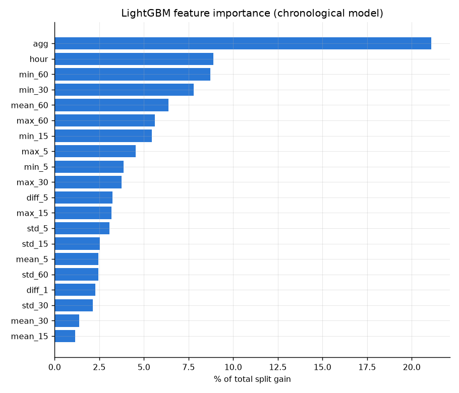
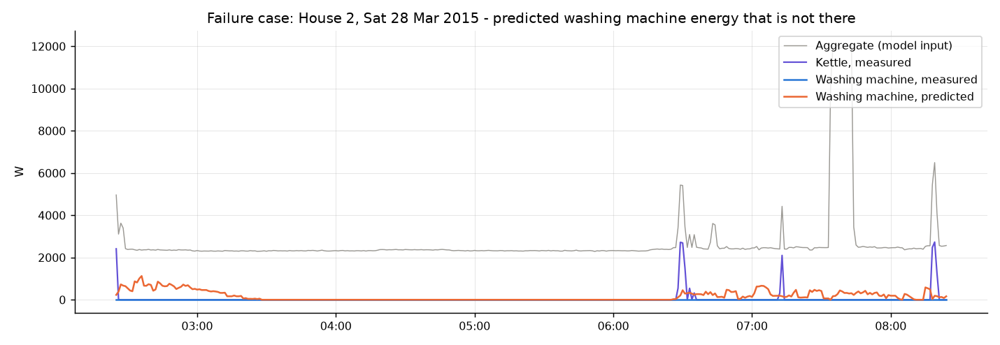

# Results

All numbers come from `src/eda_washing_machine.py` and `src/train_disaggregation.py`, run on the official cleaned files at 1-minute resolution. Every table is also saved as a csv in `outputs/tables/`. Times are UK local time; see the timestamp notes in DATA.md.

## Washing-machine EDA

### Homes and periods

I used Houses 1, 2, 3, 5 and 11, each over the full period of its cleaned file. Each of these homes has one washing machine channel. The channel numbers are listed in DATA.md.

### Availability and data quality

| House | Period | Days | Missing | Zero (0 W) | Off (< 20 W) | Cycles | Cycles / week | kWh / week |
|---|---|---|---|---|---|---|---|---|
| 1 | 2013-10-09 to 2015-07-10 | 639 | 12.6% | 97.5% | 98.1% | 373 | 4.8 | 1.76 |
| 2 | 2013-09-17 to 2015-05-28 | 617 | 24.6% | 94.3% | 95.3% | 322 | 4.9 | 3.07 |
| 3 | 2013-09-25 to 2015-06-02 | 615 | 11.4% | 92.9% | 94.2% | 573 | 8.5 | 4.90 |
| 5 | 2013-09-26 to 2015-07-06 | 648 | 9.3% | 53.4% | 94.4% | 676 | 8.3 | 3.74 |
| 11 | 2014-06-03 to 2015-06-30 | 392 | 11.0% | 91.6% | 98.4% | 75 | 1.8 | 1.22 |

How to read the columns:

- "Missing" is the share of minutes with no reading at all.
- On top of that, I drop frozen, stuck and silent stretches. The big ones are 11.7% of House 3 and 12.4% of House 11 (see DATA.md).
- "Zero" and "Off" are shares of the remaining valid minutes.
- Cycles are counted with the rule below.

What the table shows:

- The machines are off 94-98% of the time.
- House 5 sits on a few watts of standby. It reads exactly 0 W only 53% of the time, but it's under 20 W 94% of the time.
- Washing frequency goes from 1.8 cycles a week in House 11 (one person) to about 8.5 in Houses 3 and 5. That's 63-255 kWh a year.

### Cycle rule

- A cycle starts when the machine goes to 20 W or more. That's above the standby draw and the monitor noise.
- While soaking, draining or refilling, the machine drops to a few watts. So pauses of up to 15 minutes count as the same cycle, and the cycle only ends when power stays under 20 W for longer than that.
- Anything shorter than 15 minutes, or using under 0.05 kWh, is dropped. That covers door lock blips, a programme started and then cancelled, or a quick spin.

This table shows why a plain threshold isn't enough. It counts cycles for different allowed pauses:

| House | Raw on-periods | No joining | 5 min | 10 min | 15 min (used) | 30 min |
|---|---|---|---|---|---|---|
| 1 | 1,774 | 241 | 406 | 384 | 373 | 357 |
| 2 | 1,916 | 341 | 340 | 334 | 322 | 304 |
| 3 | 1,113 | 640 | 602 | 586 | 573 | 535 |
| 5 | 2,685 | 623 | 725 | 701 | 676 | 617 |
| 11 | 361 | 74 | 75 | 76 | 75 | 76 |

What it shows:

- A 20 W threshold on its own gives 2 to 6 times more "events" than there are washes.
- With no joining, House 1 actually loses a third of its washes (241 instead of 373). Its 33-minute washes break into pieces shorter than 15 minutes, and the minimum length then throws those pieces away.
- Between a 10 and a 30-minute allowed pause, the count only moves by up to 12%, so the exact value isn't critical. I picked 15 minutes because it covers soak and drain pauses but is shorter than unloading and starting a second load.

Kelly and Knottenbelt (2015) used 20 W with a 160 s minimum off time and a 30-minute minimum on time, on 6-second data. On 1-minute data, and with House 1's 33-minute programme, a longer pause and a shorter minimum work better.

### Cycle characteristics across homes

| House | Cycles | Duration (min) | Energy (kWh) | 1-min peak (W) | Heated | Heater share of energy |
|---|---|---|---|---|---|---|
| 1 | 373 | 33 (32-36) | 0.32 (0.26-0.38) | 2,328 | 98.7% | 77.9% |
| 2 | 322 | 97 (89-107) | 0.62 (0.48-0.70) | 2,091 | 97.5% | 79.4% |
| 3 | 573 | 66 (62-71) | 0.55 (0.46-0.66) | 1,926 | 99.1% | 80.5% |
| 5 | 676 | 48 (36-79) | 0.30 (0.21-0.51) | 2,077 | 88.6% | 66.3% |
| 11 | 75 | 103 (54-115) | 0.52 (0.39-0.75) | 2,313 | 96.0% | 82.5% |
| All | 2,019 | 64 (37-87) | 0.45 (0.29-0.64) | 2,074 | 95.1% | 75.8% |

- The values are medians, with the interquartile range in brackets.
- "Heated" means the 1-minute peak went over 1 kW, so the machine heated its own water.
- "Heater share" is the energy in minutes over 1 kW divided by the cycle's total energy.

The main thing here is that 95% of washes heat water, and the heater is 76% of all washing machine energy.

The homes are quite different, though:

- House 1 runs almost the same 33-minute programme every time.
- Houses 2 and 11 run programmes of about an hour and a half.
- House 5 has the widest spread. Some of its evening events last 6-9.5 hours and use 2-3.4 kWh, which fits wash-and-dry runs on its washer-dryer. Its heater share is the lowest (66%), because heat-pump drying stays under 1 kW.
- House 3's machine rarely drops below 20 W in the middle of a wash. Only 39% of its cycles needed a pause joined, compared with 75-99% in the other homes.

### Usage by hour of day and day of week

Share of cycle starts:

| House | 00-06 | 06-12 | 12-18 | 18-24 | Starts 16:00-19:00 | WM energy 16:00-19:00 | Weekend | Busiest day |
|---|---|---|---|---|---|---|---|---|
| 1 | 23.9% | 48.5% | 27.1% | 0.5% | 1.6% | 2.3% | 23.1% | Wed |
| 2 | 1.2% | 41.0% | 42.2% | 15.5% | 15.5% | 17.9% | 24.2% | Mon |
| 3 | 0.3% | 55.2% | 35.2% | 9.2% | 10.6% | 12.2% | 15.9% | Tue |
| 5 | 2.5% | 39.1% | 37.3% | 21.2% | 19.2% | 16.5% | 58.3% | Sat |
| 11 | 2.7% | 45.3% | 48.0% | 4.0% | 9.3% | 7.3% | 17.3% | Tue |
| All | 5.6% | 45.9% | 36.0% | 12.4% | 12.6% | 13.0% | 32.8% | Sat |

Most washes start in the morning and early afternoon. Evenings are less common.

House 1 does about a quarter of its washes between midnight and 6 am. Most of those start between 3 and 6 am. Its aggregate also shows a steady night load of about 1.2 kW from roughly 1 to 6 am, so it looks like the house is already on a night tariff.

Only 13.0% of washing energy falls in the 16:00-19:00 peak. That's about the window's share of the day (12.5%), so washing isn't concentrated in the peak.

The day of the week depends a lot on the household:

- House 5 does 58% of its washes at the weekend, and 39% on Saturdays alone.
- House 3 does 43% on Mondays and Tuesdays.
- Overall, Saturday is the busiest day (19.6%), mostly because of House 5.

## Plots

### (i) A representative 24-hour trace

The script picks a House 1 day that has one cycle close to the median energy and almost no missing data. On 1 April 2014 there's a single 33-minute, 0.30 kWh wash just before midday.

Its heater block (about 2.3 kW) is far from the biggest thing that day:

- there's the 1.2 kW night load with 2-3.4 kW spikes;
- there are two 10 kW blocks, which are probably an electric shower.

So a 2 kW step on its own isn't enough to say it's the washing machine. The motor pattern after it matters.

### (ii) Detected cycles

Yellow marks the heater (over 1 kW). The dashed line is 20 W, and blue shading is the detected cycle.

- House 1 heats for about 6 minutes at 2.3 kW. Then the drum turns at 80-170 W with short stops, and the cycle ends with a spin of up to about 480 W.
- House 2 heats for about 15 minutes at 2.05 kW. That's followed by 70 minutes of drum movement at 30-280 W, which dips under 20 W several times. Five on-periods get joined into one 93-minute, 0.63 kWh wash, which a plain threshold would have counted as five washes.

### (iii) Cross-house comparison

This plot shows energy and duration per cycle (boxplots), start times by hour (the grey band is 16:00-19:00), and start times by day of week.

- House 1's cycles are short and very consistent.
- Houses 2 and 3 use more energy per wash.
- House 5 is all over the place, with a long tail of wash-and-dry runs.
- The hour panel shows House 1's early-morning washes and House 11's 10-12 peak.
- The day panel shows House 5's Saturdays.

## Validation approach

The model estimates the washing machine's 1-minute power from the aggregate alone, for the same five houses. I only train and score on minutes where:

- both channels have a value;
- the aggregate isn't frozen;
- the monitor isn't stuck or silent;
- less than half of the minute is flagged by Issues.

Homes and periods:

| House | Train | Validation | Test | Test minutes | On in test |
|---|---|---|---|---|---|
| 1 | 2013-10-09 to 2014-12-31 | to 2015-03-26 | to 2015-07-10 | 116,988 | 1.97% |
| 2 | 2013-09-17 to 2014-12-23 | to 2015-03-03 | to 2015-05-28 | 99,098 | 4.98% |
| 3 | 2013-09-25 to 2014-12-23 | to 2015-03-08 | to 2015-06-02 | 97,672 | 5.74% |
| 5 | 2013-09-26 to 2014-12-22 | to 2015-03-17 | to 2015-07-06 | 118,242 | 7.96% |
| 11 | 2014-06-03 to 2015-01-19 | to 2015-03-04 | to 2015-04-26 | 63,828 | 1.18% |

That's 2.31M training minutes, and 0.50M each for validation and test. House 11 stops on 26 April 2015, which is where its monitor goes silent.

### Splits and leakage

There are two splits:

- Time split. Each house is split 70/15/15 in time order, and one model is trained on all five houses. This tests later months of a known home.
- Leave one house out. Five models, each trained on four houses and tested on the fifth house's test period. This tests a new customer.

I didn't use a random split. Neighbouring minutes are almost identical, so a random split would put pieces of the same wash in both train and test.

How leakage is kept out:

- The features only use the aggregate, never the washing machine signal.
- Every window looks backwards, so no training row sees anything from the test period.
- Validation is only used for early stopping and for choosing the output floor.
- The test set is used once.

Both splits are scored on exactly the same test minutes, so the numbers are directly comparable.

### Model and baselines

The model is LightGBM regression on 20 backward-looking features of the aggregate: the current value, mean/min/max/std over 5, 15, 30 and 60 minutes, the 1- and 5-minute change, and hour of day. The settings:

- learning rate 0.05;
- 63 leaves, with at least 100 rows per leaf;
- early stopping, which kept 148-405 trees.

Predictions below a floor chosen on validation are set to zero. The floor came out at 20 W in five of the six fits and 50 W in one.

The baselines:

- always-off (0 W);
- an hourly profile: the average washing machine power for each hour of the day in the training period. It's per house in the time split, and pooled across the training houses in leave-one-house-out.

### Metrics and why

| Metric | Why |
|---|---|
| MAE (W) | Standard error per minute. It's dominated by off minutes, so always-off already scores well on it. |
| MAE when on (W) | The error only when the true power is 20 W or more. It shows whether the model tracks the real load. |
| Precision, recall, F1 at 20 W | Whether the model knows when the machine runs, which is what any advice about washing habits needs. |
| Energy error | (predicted kWh - true kWh) / true kWh over the test period. It's what a monthly bill breakdown would show, and the same idea as the signal aggregate error in Zhang et al. (2018). |

## Model results

| Split | Method | MAE (W) | MAE when on (W) | Precision | Recall | F1 | Energy error |
|---|---|---|---|---|---|---|---|
| Time | Always off | 18.6 | 397 | 0 | 0 | 0 | -100% |
| Time | Hourly profile | 30.2 | 371 | 0.095 | 0.648 | 0.166 | -23% |
| Time | LightGBM | 21.2 | 300 | 0.324 | 0.553 | 0.409 | -31% |
| Unseen house | Always off | 18.6 | 397 | 0 | 0 | 0 | -100% |
| Unseen house | Hourly profile | 30.7 | 376 | 0.087 | 0.613 | 0.152 | -23% |
| Unseen house | LightGBM | 24.6 | 346 | 0.254 | 0.454 | 0.325 | -35% |

| House | F1 (time) | F1 (unseen) | Energy error (time) | Energy error (unseen) |
|---|---|---|---|---|
| 1 | 0.431 | 0.367 | -4% | -24% |
| 2 | 0.378 | 0.291 | -1% | -22% |
| 3 | 0.526 | 0.475 | -20% | -26% |
| 5 | 0.337 | 0.212 | -72% | -78% |
| 11 | 0.123 | 0.130 | +14% | +486% |

The model is clearly better than both baselines at telling when the machine is on. Its F1 is 0.41, against 0.17 and 0. It also tracks the power level better while the machine runs, with about 300 W of error against about 400 W.

Two numbers look better than they are:

- Always-off has the best plain MAE (18.6 W). The machine is off 95% of the time, so predicting nothing is almost always right, and every false alarm costs more than a correct detection saves.
- The hourly profile gets total energy within 23% while knowing nothing about when washes happen.

The model's total energy comes out 31% low, mostly because of House 5. In the other four houses the error is between -20% and +14%.

On a house it has never seen, F1 drops to 0.33. House 3 holds up best (0.53 down to 0.48), and House 5 worst (0.34 down to 0.21).

House 11 is the weakest, partly because of its data:

- one person washing about twice a week means the machine is only on 1.2% of the time, so even a few false alarms swamp it (precision 0.09);
- two thirds of its heating minutes are dropped because of the sensor mismatch.

I tried two other things on the time split, and left both out of the scripts:

- Forward-looking windows (the next 15, 30 and 60 minutes) raised F1 from 0.41 to 0.44 and lowered MAE from 21.2 to 19.3 W. That's a real gain but a small one.
- Features for "load above the 60-minute minimum" made no difference (F1 0.40).

### Actual vs predicted

This shows one test-period cycle per house: the one with median energy, so it isn't picked to look good. Grey is the aggregate (what the model sees), blue is the real washing machine, and orange is the prediction. Gaps in the orange line are minutes left out of scoring.

- Timing is mostly right in every house, but the heater power is usually too low.
- House 2 is the best: the prediction reaches 1.0-1.7 kW against a 2.1 kW block.
- In Houses 1, 3 and 5 the prediction stays under about 1 kW, because other 1-4 kW loads switch on and off around the same time.
- In House 2, a 10 kW block straight after the wash (probably the shower) only gets 100-200 W of predicted washing machine power.
- House 11's plot is only a fragment. Its heater block is excluded because the monitor reads higher than the whole house.

### Feature importance

- The current aggregate is the strongest feature (21% of split gain).
- The rolling minimums come next: min_60 8.7%, min_30 7.8%, min_15 5.4% and min_5 3.9%, about 26% together. They describe the house's base load, so the model is looking at how far above it the current reading is.
- Hour of day is the second strongest single feature (8.9%). That means the model partly learns each home's routine, which helps for a known home but not for a new one.
- The 1-minute change only gets 2.3%, because at 1-minute resolution the heater switching on is often split over two minutes.

## Failure analysis

### 1. Other heating loads

Kettles, dishwashers, tumble dryers and House 1's washer-dryer all draw about 2 kW, just like the heater.

| House | False "on" minutes | False kWh | Other heater on (> 500 W) during false "on" | Other heater on, all test minutes |
|---|---|---|---|---|
| 1 | 5,354 | 10.5 | 23.0% | 3.2% |
| 2 | 6,722 | 20.0 | 33.8% | 3.8% |
| 3 | 8,027 | 18.9 | 46.8% | 6.0% |
| 5 | 4,847 | 8.0 | 25.5% | 1.8% |
| 11 | 1,600 | 2.2 | 16.6% | 1.1% |

These heaters are only on in 1-6% of test minutes, but they're on during 17-47% of the false alarms. That's 7-15 times more than chance. Most of the rest is probably unmetered loads like water heating, the oven or a shower.

This shows the 6 hours with the most made-up washing machine energy: House 2, Saturday 28 March 2015, 02:25-08:25.

- The aggregate sits at a flat 2.3-2.4 kW all night. That load is unmetered, probably water or storage heating on a night tariff.
- Kettle boils sit on top of it at about 06:30, 07:10 and 08:20.
- The model predicts up to about 1.2 kW of washing machine around 02:30-03:15 and again after 06:30, but the machine never ran.

To backward-looking statistics, a flat 2.3 kW block looks a lot like a heater phase.

### 2. Cold washes and drying

Without the heater, a wash is just a few hundred watts of motor, which looks like lots of other things. I count a test cycle as caught when at least half its minutes are predicted on. The model catches:

- 67.1% of the 255 heated cycles (100% in House 1, 96% in House 3);
- only 10.0% of the 30 unheated cycles.

### 3. Behaviour that changes, and new homes

House 5 was on 3.8% of the time in training, but 8.0% in test. From February 2015 it started doing long evening wash-and-dry runs (6-9 hours, mostly under 1 kW) that hardly happened in 2014. The model catches only 31% of House 5's heated test cycles and misses 72% of its energy.

A new customer is the same problem, only bigger. Without the house's own history, F1 drops by 0.05-0.13 in four of the five houses. House 11 stays at 0.12-0.13.

## Interpretation

For most homes, the model can say roughly when a house washes and roughly how much energy the washing machine uses per month. It finds two thirds of heated washes and gets energy within 20% in four of five homes.

It's not good enough for:

- minute-level power;
- single washes while other heaters are running;
- washer-dryers.

For new homes it should be treated as a rough estimate.

The heater is both most of the energy (76%) and what the model sees best. So the most useful thing it can support is advice about heated washes rather than timing, which is what Recommendation.md covers.
